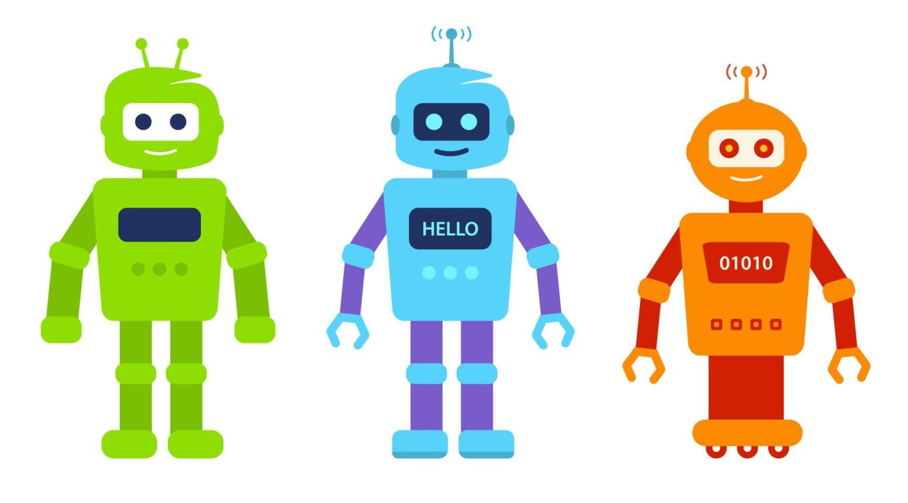

# Robots

## Ausgangssituation

Du entwickelst ein kleines Roboterspiel. Es gibt drei Roboter. Jeder Roboter hat:

- eine Farbe
- einen Energiewert
- eine Information, ob er laufen kann

Bisher wurde das Programm ohne Klassen geschrieben (siehe Klasse `RobotGame`).

## Problem

Stell dir vor, das Spiel bekommt 100 Roboter. Jeder hat weiterhin drei Eigenschaften.

- Wie viele Variablen brauchen wir?
- Was passiert, wenn ein Roboter eine neue Eigenschaft bekommt?

## Aufgabe

1. Erstelle eine Klasse `Robot` (in einer neuen Datei).
2. Verschiebe die Eigenschaften der Roboter in diese Klasse.
3. Erstelle die drei Roboter als eigenständige Objekte (in `RobotGame.main()`).
4. Weise jedem Roboter seine ursprünglichen Werte zu.
5. Gib die Eigenschaften aller drei Roboter aus.
